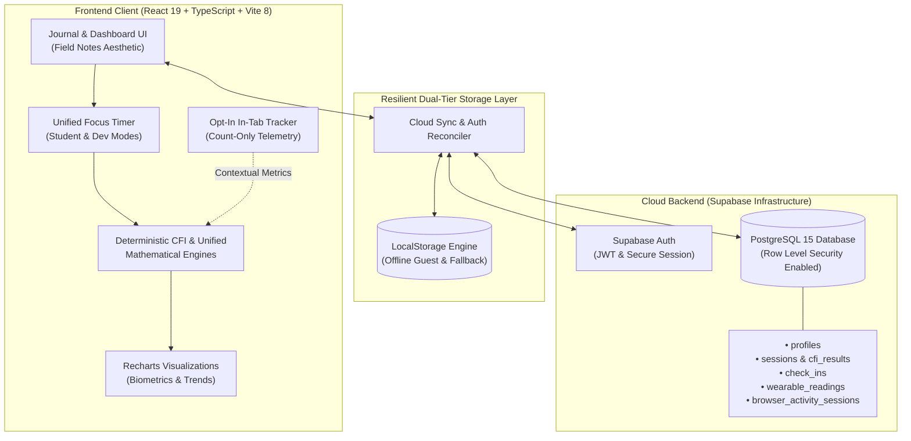

# 🛰️ Burnout Radarr

> **Catch the signals. Find your balance.**  
> A privacy-first, evidence-grounded cognitive recovery and focus journal that quantifies mental fatigue, paces deep work, and prevents burnout—without surveillance or black-box ML.

[](https://react.dev/)
[](https://www.typescriptlang.org/)
[](https://vitejs.dev/)
[](https://supabase.com/)
[](https://pmc.ncbi.nlm.nih.gov/articles/PMC10298359/)
[](https://github.com/)

---

## 🎯 Headline & Elevator Pitch

**Burnout Radarr is an "antigravity" cognitive recovery platform that couples deterministic Cognitive Fatigue Index (CFI) algorithms with personalized biometric baselines to safeguard developers and students from acute mental exhaustion—delivering deep work pacing and restorative insights with zero surveillance.**

```
+-------------------------------------------------------------------------------------------------+
|                                    BURNOUT RADARR AT A GLANCE                                   |
|                                                                                                 |
|   🎓 STUDENT MODE              💻 DEVELOPER MODE             🧬 UNIFIED CFI ENGINE              |
|   • Safe Study Envelopes       • Task-Complexity Weighting   • 50% Subjective Micro Check-ins   |
|   • Spaced Retrieval Prompts   • NASA-TLX Friction Scores    • 50% Wearable Biometrics (HRV/MAD)|
|   • Rest-Day Distress Resets   • Focus Shielding (45-90m)    • Non-Parametric Dynamic Baselines |
|   • Exam Countdown Pacing      • Context-Switch Checkpoints  • Transparent Math (Zero Black-Box)|
+-------------------------------------------------------------------------------------------------+
```

---

## 💡 Inspiration

Knowledge workers are burning out in record numbers. In high-stakes academia and software engineering, exhaustion is routinely glorified until cognitive collapse forces an emergency shutdown. 

When we examined the existing landscape of "productivity" and "wellness" software, we found two deeply problematic extremes:
1. **Invasive Surveillanceware:** Tools that capture webcam video, log keystrokes, track gaze, or take random desktop screenshots. These induce anxiety, destroy trust, and actively exacerbate psychological distress.
2. **Naive Pomodoro Clocks:** Timers that treat every minute of focus identically—assuming 25 minutes of boilerplate docs strains your brain the same way as 25 minutes of deep concurrent debugging or multivariable calculus.

Worst of all, people are biologically terrible at self-assessing fatigue in real time. Seminal occupational health research (**Blasche et al., 2023**) uncovered **"The Vigor Paradox"**: subjective morning alertness is mathematically orthogonal to preceding-day cognitive strain ($p = 0.713$). **You can feel energetically "ready to sprint" while your neurocognitive reserves are dangerously depleted.**

We asked ourselves:  
*What if we built a lightweight, privacy-respecting tool grounded in verified cognitive science that acts as an early-warning radar for mental fatigue—empowering users to pace their ambition sustainably?*

---

## ⚙️ What It Does

Burnout Radarr replaces intrusive monitoring with **intentional, low-friction micro-reflections and biometric baselines**. Designed with a warm, tactile "Personal Field Notes" aesthetic, it balances focus acceleration with cognitive preservation.

### 1. Dual-Core Cognitive Fatigue Index (CFI)
The platform evaluates cognitive fatigue along two rigorous vectors:
* **Session-Level CFI (0–100):** A transparent, deterministic heuristic evaluating:
  - **Self-Reported Fatigue (50% weight):** Standardized Likert-scale self-rating.
  - **Sleep Deficit (25% weight):** Delta against an experimental 8-hour baseline.
  - **Pacing & Break Deficit (25% weight):** Pacing balance evaluated against an optimal 1:5 break-to-focus ratio.
* **Unified Multi-Domain CFI (0–100):** Evaluates multi-day recovery by combining:
  - **Subjective Domain (50%):** Morning readiness and evening reflections ($25 \times (5 - \text{response})$).
  - **Wearable Biometric Domain (50%):** Physiological strain derived from Heart Rate Variability (HRV RMSSD) and nocturnal sleep duration.

```
                      ┌───────────────────────────────────────┐
                      │        UNIFIED CFI SCORE (0-100)      │
                      └──────────────────┬────────────────────┘
                                         │
                 ┌───────────────────────┴───────────────────────┐
                 ▼ (50% Weight)                                  ▼ (50% Weight)
  ┌─────────────────────────────┐                 ┌─────────────────────────────┐
  │      SUBJECTIVE DOMAIN      │                 │       WEARABLE DOMAIN       │
  │ • Morning Readiness         │                 │ • Overnight HRV RMSSD (log) │
  │ • Evening Reflection        │                 │ • Total Sleep Duration      │
  │ • Scaled 1-5 Micro-Survey   │                 │ • 14-28 Day Dynamic Median  │
  │ • Standardized 0-100 Delta  │                 │ • Robust MAD-Score Deficit  │
  └─────────────────────────────┘                 └─────────────────────────────┘
```

### 2. Tailored Cognitive Modes
* 🎓 **Student Mode (Curriculum & Exam Preparation):**
  - **Safe Study Duration Envelope:** Visual indicators remain green within the scientifically supported 1–4 hour optimal daily zone, transition to amber caution at 4–6 hours, and trigger high-fatigue escalation alerts past 6 hours (Blasche et al., 2023).
  - **Spaced Retrieval Over Passive Cramming:** Active recall prompts interrupt passive re-reading to defeat the "illusion of competence" (Yuriev et al., 2026).
  - **Distress-Reset Rest Days:** Enforces zero-study recovery days to reset baseline psychological distress without streak penalties.
  - **Exam Proximity Damping:** Power-curve countdown buffers that automatically recommend lighter review as high-stakes exam dates approach.
* 💻 **Developer Mode (Software Engineering & Architecture):**
  - **Task-Complexity Cognitive Weighting:** Reflects working-memory load across engineering tasks—debugging (1.3× multiplier), code comprehension/architecture (1.2×), feature development (1.0×), refactoring/testing (0.9×), and documentation (0.7×) (Gonçales et al., 2021).
  - **NASA-TLX Micro-Surveys:** Ultra-low friction 2-question post-session check-in capturing Mental Demand and Frustration.
  - **Context-Switch Shielding:** Encourages protected 45–90 minute deep-work blocks with 1-click state checkpoint markers before meetings or interruptions.

### 3. Radical Privacy by Design
* **Count-Only Browser Telemetry:** In-tab activity tracking counts `keydown` and primary mouse clicks in memory. **Zero keystrokes, text strings, form values, page URLs, or screen coordinates are ever inspected, captured, or transmitted.**
* **Zero Machine-Learning Hallucinations:** Real-world ML cognitive load classification suffers massive precision drops (Gonçales et al., 2021). Burnout Radarr uses 100% explainable, deterministic mathematics.
* **Missing Data Integrity:** If wearable readings or morning check-ins are missing, the CFI displays as `Pending` with descriptive diagnostics. **Missing values are never faked, zeroed, or imputed.**

---

## 🛠 How We Built It

Burnout Radarr was engineered as a high-performance, responsive single-page web app backed by a PostgreSQL database with cryptographic Row Level Security (RLS).



### Tech Stack Breakdown

| Layer | Technologies | Justification & Purpose |
| :--- | :--- | :--- |
| **Frontend Framework** | **React 19.3.1**, React DOM | Modern hooks architecture, concurrent rendering, and zero-overhead component transitions. |
| **Build & Tooling** | **Vite 8.3.6**, TypeScript 6.0 | Sub-second HMR development cycles; ultra-fast production bundle compilation (878ms). |
| **Data Visualization** | **Recharts 3.10.1** | Responsive SVG biometric line charts, area plots, and categorical focus distribution wheels. |
| **Design & Iconography**| **Lucide React**, CSS Custom Variables | Tactile editorial field-notes aesthetic with full dark, light, and system theme adaptability. |
| **Backend & Database** | **Supabase (PostgreSQL 15)** | Relational schema with foreign keys, composite constraints, and strict Row Level Security (RLS). |
| **Authentication** | **Supabase Auth (GoTrue)** | Secure token persistence, email/password flows, and session recovery. |
| **Biometric Math** | **Pure TypeScript Algorithms** | Non-parametric statistics: Median, Median Absolute Deviation (MAD), and log-normal transforms. |

### The Mathematics Behind the CFI

#### 1. Session Duration Fatigue Penalty
Reflecting empirical findings that fatigue accelerates non-linearly past 4 hours and spikes past 6 hours:
$$\text{Duration Factor} = \begin{cases} 1.0 \times \text{Hours} & \text{if Hours} \le 4 \\ 4.0 + 1.5 \times (\text{Hours} - 4) & \text{if } 4 < \text{Hours} \le 6 \\ 7.0 + 2.5 \times (\text{Hours} - 6) & \text{if Hours} > 6 \end{cases}$$


#### 2. Robust Biometric Deviation (MAD Normalization)
Individual HRV varies widely between people (20ms to 120ms+), rendering fixed thresholds meaningless. We calculate standardized deficits using the **Median Absolute Deviation (MAD)** against a rolling 14–28 day personal baseline:
$$\text{MAD} = \text{median}(|X_i - \text{median}(X)|)$$
$$\text{Robust } Z\text{-Score} = \frac{\text{median}_{\text{baseline}}(\ln(\text{RMSSD})) - \ln(\text{RMSSD}_{\text{current}})}{1.4826 \times \text{MAD}}$$
$$\text{Wearable Signal Score} = \min(100, \, \max(0, \, \text{Robust } Z\text{-Score} \times 50))$$

---

## 🚧 Challenges We Ran Into

### 1. Taming Biometric Outliers Without Brittle ML
* **The Hurdle:** Consumer wearable data (such as Apple Watch or Oura Ring HRV) is plagued by high daily variance, motion artifacts, and sleep disruption. Standard machine learning models trained on lab cohorts fail in real-world scenarios.
* **Our Solution:** Instead of deploying a brittle black-box neural net, we implemented **non-parametric robust statistics**. By computing log-transformed RMSSD against an individual's personal 14–28 day median and scaling by MAD, the algorithm adapts to each user's unique physiology while resisting sporadic outliers.

### 2. The Missing Data Trap & Defensive Diagnostics
* **The Hurdle:** Many wellness apps silently impute missing biometric or check-in data with zeros, causing user fatigue scores to falsely plummet to "safe" levels when users simply forgot to wear their watch.
* **Our Solution:** We engineered an uncompromising **Pending State Architecture**. If either the subjective check-in or the wearable baseline is incomplete, the Unified CFI refuses to guess. Instead, it marks the score as `Pending` and outputs a crystal-clear checklist of missing inputs.

### 3. Keystroke Telemetry Without Spyware Paranoia
* **The Hurdle:** We wanted to provide work-rhythm context (active engagement vs. idle time) without crossing into invasive employee-monitoring behavior.
* **Our Solution:** We built a tab-scoped tracker with strict privacy boundaries:
  ```typescript
  // Counts keypress occurrences without reading event properties
  const countKeyPress = () => {
    if (document.visibilityState !== 'visible') return;
    setMetrics(prev => ({ ...prev, keyPressCount: prev.keyPressCount + 1 }));
  };
  ```
  It discards all keycodes, character values, cursor positions, and clipboard contents. Furthermore, browser activity carries **0% scoring weight** in the CFI calculation—it serves purely as reflective personal context.

### 4. Seamless Offline-to-Cloud State Migration
* **The Hurdle:** Hackathon judges and demo users often want to test an app immediately without creating an account first, yet authenticated users need cloud-synced sessions across devices.
* **Our Solution:** We created a dual-tier storage bridge with automatic vault reconciliation. Users can run completely offline as guests with full localStorage backup. When they sign up or log in, their local guest sessions are seamlessly preserved, migrated, and linked to their Supabase account with RLS enforcement.

---

## 🏆 Accomplishments That We're Proud Of

* 🔬 **Grounded in 3 Seminal Peer-Reviewed Papers:** Not a generic timer with a fresh coat of paint. Every threshold, multiplier, and recommendation maps directly to empirical data from:
  1. *Yuriev et al. (2026)* — 65 STEM studies on active recall and desirable difficulties (*IJ STEM Ed*).
  2. *Blasche et al. (2023)* — 411 daily medical diaries on study duration, vigor decoupling, and rest days (*Healthcare*).
  3. *Gonçales et al. (2021)* — 63 empirical software engineering studies on developer cognitive load and NASA-TLX (*Info & Software Tech*).
* 🧮 **100% Explainable Mathematical Provenance:** Every CFI score generates a granular breakdown (e.g., *"Subjective fatigue: 37.5/100 from morning check-in; Sleep: 1.2h below baseline contributing 3.8 pts"*). Zero AI hallucination, zero mysterious score shifts.
* 🛡️ **Zero-Surveillance Architecture:** Industry-leading privacy standards with count-only in-memory telemetry, strict Supabase Row Level Security (RLS), and completely anonymized research aggregates.
* ⚡ **Blazing Fast Performance:** React 19 + Vite 8 bundle compiles in **878ms** with sub-second production builds and zero lag.
* 🧪 **Comprehensive Automated Test Coverage:** Five independent test suites verifying CFI math, unified multi-domain scoring, mode workflows, cloud mapping, and storage fallbacks.

---

## 📖 What We Learned

1. **Vigor is Deceptive:** High perceived energy does not equal cognitive reserve. Designing the CFI to evaluate objective workload and sleep duration prevents users from running on "caffeine fumes" during high-stress sprints.
2. **Effortful Strategies Require Low-Friction Scaffolding:** Cognitive science proves that spaced retrieval practice and interleaved problem sets dramatically improve retention, yet students resist them because they feel difficult. Low-friction in-session prompts make evidence-based habits effortless to adopt.
3. **Simplicity Trumps Complex AI:** In health and cognitive monitoring, transparent rule-based heuristics and robust baselines yield far higher user trust and reliability than fragile black-box predictive models.

---

## 🚀 What's Next

- [ ] **Direct Wearable Integrations:** Native Web Bluetooth and OAuth connectors for Apple HealthKit, Whoop 4.0, Oura Ring Gen 3, and Garmin Health APIs.
- [ ] **IDE Focus Extensions:** Lightweight VS Code and JetBrains plugins that synchronize Developer Mode focus blocks directly from your code editor.
- [ ] **Ambient Physiological Audio:** Dynamic binaural audio and 2-minute physiological sigh breathwork timers triggered during break intervals.
- [ ] **Anonymized Team Crunch Radars:** Opt-in aggregated cohort insights for engineering leads and university departments to detect systemic team crunch before burnout occurs.

---

## 💻 Installation & Setup

Get Burnout Radarr running locally in under two minutes.

### Prerequisites
* **Node.js:** v18.0.0 or higher (Node v20+ or v26 recommended)
* **npm:** v9.0.0 or higher

### Quick Start

```bash
# 1. Clone the repository
git clone https://github.com/your-username/burnout-radarr.git
cd burnout-radarr

# 2. Install dependencies
npm install

# 3. Start the local development server
npm run dev
```

Open your browser and navigate to `http://localhost:5173`. You can immediately use the app in **Offline Guest Mode** with full functionality!

### (Optional) Connecting Supabase Cloud Backend

To enable multi-device cloud synchronization and authentication:

1. Create a free project at [supabase.com](https://supabase.com).
2. Execute the migration scripts located in `supabase/migrations/` in your Supabase SQL Editor:
   - `20261113000000_create_burnout_radarr_schema.sql`
   - `20261115000000_create_check_ins.sql`
   - `20261116000000_create_wearable_readings.sql`
   - `20261116000001_create_browser_activity_sessions.sql`
3. Create a `.env` file in the project root:
   ```env
   VITE_SUPABASE_URL=https://your-project-id.supabase.co
   VITE_SUPABASE_ANON_KEY=your-anon-publishable-key
   ```
4. Restart the development server (`npm run dev`).

### Running the Test Suites

The codebase includes self-contained test suites covering all core algorithmic and data layers:

```bash
# Test Core Deterministic CFI Calculator
node src/features/cfi/calculateCFI.test.ts

# Test Unified Multi-Domain CFI (Biometric & MAD baseline)
node src/services/unified-cfi.test.ts

# Test Student & Developer Mode Drafts and State Transitions
node src/features/modes.test.ts

# Test CFI Display and Formatting Logic
node src/services/cfi-display.test.ts

# Test CFI Integration and Engine Injection
node src/services/cfiIntegration.test.ts

# Test Cloud Sessions and Storage Fallbacks
node src/services/cloud-sessions.test.ts
```

### Production Build

```bash
npm run build
npm run preview
```

---

## 📚 Scientific Bibliography & Empirical Sources

1. **Yuriev, E., Chen, S. Q., Vo, K., Terrill, A. E., Gomes, J., Kyne, S. H., & Sarkar, M. (2026).**  
   *STEMing evidence-based study strategies: a systematic review of literature.*  
   *International Journal of STEM Education*, 13, 45.  
   DOI: [10.1186/s40594-026-00632-z](https://link.springer.com/article/10.1186/s40594-026-00632-z)
2. **Blasche, G., Khanaqa, T. A. K., & Wagner-Menghin, M. (2023).**  
   *Mentally Demanding Work and Strain: Effects of Study Duration on Fatigue, Vigor, and Distress in Undergraduate Medical Students.*  
   *Healthcare*, 11(12), 1782.  
   PMCID: [PMC10298359](https://pmc.ncbi.nlm.nih.gov/articles/PMC10298359/) | DOI: [10.3390/healthcare11121782](https://doi.org/10.3390/healthcare11121782)
3. **Gonçales, L. J., Farias, M. A., & da Silva, F. Q. (2021).**  
   *Measuring the cognitive load of software developers: An extended Systematic Mapping Study.*  
   *Information and Software Technology*, 138, 106563.  
   DOI: [10.1016/j.infsof.2021.106563](https://doi.org/10.1016/j.infsof.2021.106563)

---

## 📄 License

This project is licensed under the MIT License — see the [LICENSE](LICENSE) file for details.

---

<p align="center">
  <b>Burnout Radarr</b> · Built with care for deep thinkers and creators everywhere.
</p>
